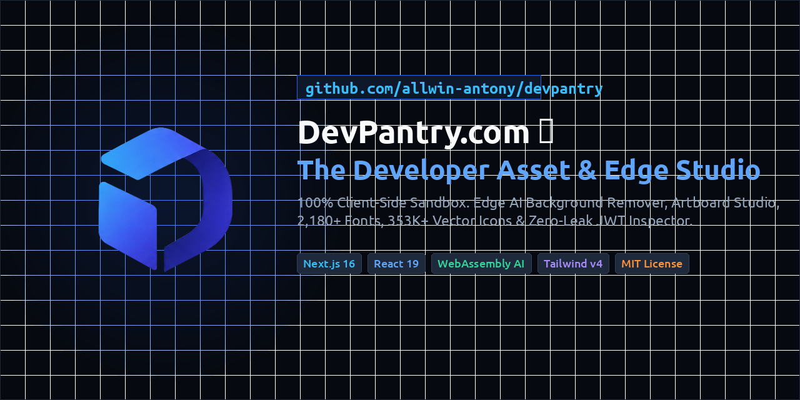

<p align="center">
  
</p>

# DevPantry

### The privacy-first developer toolbox for building, testing and breaking things.

Image processing, JWT inspection, chaos data, API fixtures, social previews, fonts, icons, developer registries and collaborative tools — designed to run in your browser whenever possible.

[](LICENSE)
[](https://nextjs.org)
[](https://react.dev)
[](https://www.typescriptlang.org)
[](https://github.com/allwin-antony)

*[_link](https://devpantry.com/)*

---

## Why DevPantry?

**🔒 Privacy-first**  
Sensitive files, tokens and test data are processed locally whenever possible.

**⚡ Fast**  
Static delivery and browser-native APIs keep tools responsive without backend round trips.

**🧪 Built for edge cases**  
Generate malformed tokens, strange Unicode, broken media, extreme data and other production failures.

**🚫 No account required**  
Open a tool and use it.

**🌐 Open source**  
Inspect how the tools work and contribute improvements.

---

## Privacy Model

| Tool type                | Data leaves browser?                    |
| ------------------------ | --------------------------------------- |
| Image processing         | ❌ No                                    |
| JWT inspection           | ❌ No                                    |
| Mock data generation     | ❌ No                                    |
| Schema builder           | ❌ No                                    |
| Font testing             | ❌ No                                    |
| Icon customization       | Browser/API dependent                   |
| Social Preview URL fetch | ⚠️ Yes — metadata fetch                 |
| Collaboration            | ⚠️ Encrypted updates are relayed and stored by Cloudflare |

---

## The Toolbox

### 🖼️ Create & Transform
* **[Background Remover](/tools/background-remover)**: 100% local AI neural inference via WebGPU.
* **[Image Resizer](/tools/image-resizer)**: Aspect ratio framing and smart padding.
* **[Image Compressor](/tools/image-compressor)**: Target KB budgeting.
* **[PNG to WebP Converter](/tools/png-to-webp)**: Fast, private client-side WebP conversion.
* **[PDF Tools](/tools/image-to-pdf)**: Client-side merge, compress, and photo kit.
* **[EXIF Stripper](/tools/exif-stripper)**: Canvas stripping technique to remove metadata.
* **[Strip GPS from Photo](/tools/strip-gps-from-photo)**: Remove location coordinates and EXIF before sharing.
* **[HEIC Converter](/tools/heic-converter)**: Fast & private WebAssembly decoding.

### 🧪 Test & Debug
* **[JWT Inspector](/tools/jwt-decoder)**: Decode, validate, and chaos-tamper JWTs in-memory.
* **[Chaos Data Studio](/tools/mock-data)**: Synthesize high-entropy mock datasets.
* **[JSON to TS & Zod](/tools/json-to-ts-zod)**: Client-side AST parsing with `#state=` link sharing.
* **[JSON to Zod Generator](/tools/json-to-zod)**: Generate runtime Zod validation schemas from JSON payloads.
* **[API Templates](/tools/api-templates)**: Real-world response fixtures for Stripe, Supabase, etc.
* **[Social Share Preview](/tools/social-preview)**: Multi-platform mockups and OG checker.
* **Media Card Tester** *(Beta)*: Stress-test media cards with realistic and broken content (missing images, extremely long descriptions, error states) before shipping them.

### 🎨 Design Resources
* **[Fonts Studio](/fonts)**: 2,100+ free font families with live testing and source-specific licenses.
* **[Icons Studio](/icons)**: 350k+ vector icons across 238 open-source toolkits.

### 🤝 Collaboration
* **[Encrypted Collaborative Editor](/tools/collab)**: Yjs editing with browser-side AES-GCM encryption, a WebSocket relay, and encrypted update storage.

### 📚 Developer Registries
* **[Public APIs Registry](/tools/public-apis)**: Searchable registry of 3k+ free public APIs.
* **[AI MCP & Tools Registry](/tools/mcp-registry)**: 4k+ open-source Model Context Protocol servers.

---

## Architecture & Documentation

DevPantry is a static-first, client-heavy application. Most processing happens inside the browser using Web APIs, WebAssembly, WebGPU and Canvas.

Detailed documentation is available in the `docs/` directory:
* **[Architecture](./docs/architecture.md)** — Detailed breakdown of performance optimizations, SEO routing, and tool implementations.
* **[Privacy](./docs/privacy.md)** — Local processing, network features, and usage analytics.
* **[Search recovery](./docs/search-recovery.md)** — Deployment verification, Search Console follow-up, and completion measurement.
* **[Contributing](./docs/contributing.md)** — Local development setup and contribution guidelines.

---

## 💻 Developer Quickstart

### Prerequisites
* **Node.js**: `v18.0.0` or higher (`v20+` / `v24+` recommended)
* **npm**: `v9.0.0` or higher

### Installation

```bash
# Clone the repository
git clone https://github.com/allwin-antony/devpantry.git
cd devpantry

# Install dependencies (Automatically downloads ~200MB of AI models locally via postinstall)
npm install

# Start local development server
npm run dev
```

Open **http://localhost:3000** in your browser.

---

## 🛠️ Technology Stack

* **Framework**: Next.js 16 (App Router with Turbopack)
* **Runtime**: React 19 + TypeScript
* **Styling**: Tailwind CSS v4 (`@tailwindcss/postcss`) + Custom Design Tokens
* **Edge AI**: `@imgly/background-removal` (WebAssembly + WebGL) with local ISNet model serving
* **Icons**: Lucide React
* **Dataset**: OpenSourceDataset (Fonts, Icons, Service Responses)
* **Author**: [Allwin S Antony](https://github.com/allwin-antony)
* **License**: MIT License
